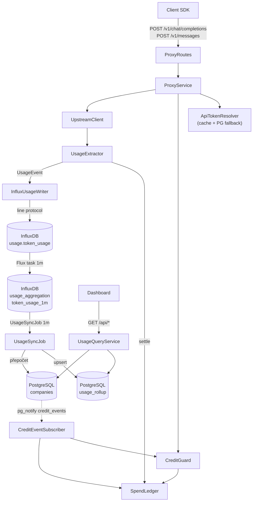

# CQRS.md – Token Router

Dokument definuje **CQRS** (Command Query Responsibility Segregation) v Token Routeru:
rozdělení zápisu usage a čtení statistik, tok dat mezi InfluxDB a PostgreSQL, agregaci
po minutách, konzistenci a failure modes.

Schéma entit, DDL jsou v [`Entity.md`](Entity.md). Tento dokument
je neduplikuje, pouze se na ně odkazuje.


## 2. Hranice systémů

| Část | Úložiště | Role |
|---|---|---|
| `usage.token_usage` | InfluxDB | zdroj pravdy o usage, append-only eventy |
| `usage_aggregation.token_usage_1m` | InfluxDB | minutové snapshoty (derived, ale stále write side) |
| `usage_rollup` | PostgreSQL | read model pro dashboard |
| `companies` | PostgreSQL | control plane + denormalizovaný credit stav |
| `users`, `api_tokens` | PostgreSQL | control plane |
| `aggregation_checkpoint` | PostgreSQL | stav sync jobu (`closed_at` watermark) |

Zdroje pravdy:

- **Usage** = InfluxDB. Při rozporu s `usage_rollup` je správně InfluxDB a rollup se
  doplní backfillem.
- **Identita, limity, tokeny** = PostgreSQL. InfluxDB obsahuje jen jejich ID.

## 3. Topologie



## 4. Command side

### 4.1 Billable request (usage write)

1. `ApiTokenResolver` ověří token.
2. `RequestEstimator` odhadne input tokeny.
3. `CreditGuard.authorize()` zkontroluje `SpendLedger`.
4. `UpstreamClient` forwarduje request na providera.
5. `UsageExtractor` vytvoří `UsageEvent`.
6. `SpendLedger.settle()` přičte skutečnou spotřebu.
7. `InfluxUsageWriter.write(event)` zapíše bod do `usage.token_usage`.

### 4.2 Control plane commandy

CRUD uživatelů a tokenů zapisuje přímo do PostgreSQL (transakčně) a po commitu
publikuje `api_token_events`:

- `ApiTokenEventSubscriber` invaliduje `ApiTokenCache`.
- Deaktivace uživatele revokuje jeho tokeny (`revoked_at = now()`).
- Tokeny se nikdy nemažou tvrdě; `api_tokens.id` zůstává stabilní pro InfluxDB.

## 5. Aggregace ve write modelu

Proxy zapisuje raw eventy. InfluxDB task z nich každou minutu dělá snapshot
`token_usage_1m`:

```flux
option task = {
    name: "aggregate_usage_1m",
    every: 1m,
    offset: 10s,
}

from(bucket: "usage")
    |> range(start: -5m)
    |> filter(fn: (r) => r._measurement == "token_usage")
    |> filter(fn: (r) =>
        r._field == "input_tokens" or
        r._field == "output_tokens" or
        r._field == "total_tokens"
    )
    |> aggregateWindow(
        every: 1m,
        fn: sum,
        createEmpty: false,
        timeSrc: "_start",
    )
    |> to(
        bucket: "usage_aggregation",
        org: "tokenrouter",
        measurement: "token_usage_1m",
    )
```


## 6. Read side

### 6.1 `usage_rollup`

Minutový read model v PostgreSQL. Upsert podle PK
`(company_id, api_token_id, provider, model, window_start)` zaručuje, že opakovaný
import nevytvoří duplicity.

```sql
INSERT INTO usage_rollup
    (company_id, api_token_id, provider, model, window_start,
     input_tokens, output_tokens, total_tokens)
VALUES (?, ?, ?, ?, ?, ?, ?, ?)
ON CONFLICT (company_id, api_token_id, provider, model, window_start)
DO UPDATE SET
    input_tokens  = EXCLUDED.input_tokens,
    output_tokens = EXCLUDED.output_tokens,
    total_tokens  = EXCLUDED.total_tokens;
```

### 6.2 Checkpoint a `closed_at`

`aggregation_checkpoint` drží dva oddělené údaje:

- `last_window_start` – poslední event aby se vykryly failnuté joby.

`closed_at = floor(now() - LATE_GRACE, 1 min)`. Nikdy se neposouvá zpět a nikdy
nepřekročí `now() - LATE_GRACE`.

Důsledek pro dashboard:

- `window_start < closed_at` → final data,
- `window_start >= closed_at` → provisional (poslední 1–2 minuty se mohou změnit).

### 6.3 `UsageSyncJob`

Běží každou minutu, v jedné instanci (advisory lock), a je idempotentní.

```kotlin
class UsageSyncJob(
    private val influx: InfluxUsageReader,
    private val rollup: UsageRollupRepository,
    private val checkpoint: UsageCheckpointRepository,
    private val credits: CompanyCreditRepository,
) {
    suspend fun runOnce() {
        if (!checkpoint.tryAdvisoryLock()) return
        try {
            val state = checkpoint.load()
            val from = state.closedAt?.minus(OVERLAP)
                ?: Instant.now().minus(OVERLAP).minus(WINDOW)

            val rows = influx.readSnapshots(from)       // token_usage_1m
            if (rows.isEmpty()) {
                checkpoint.touch()                      // updated_at = now()
                return
            }

            transaction {
                rollup.upsertAll(rows)                  // idempotentní
                val companyIds = rows.map { it.companyId }.distinct()
                credits.recompute(companyIds)           // credit_spend + has_credits
                checkpoint.save(
                    lastWindowStart = rows.maxOf { it.windowStart },
                    closedAt = floorMinute(Instant.now().minus(LATE_GRACE)),
                )
            }
            credits.publishEvents(companyIds)           // pg_notify credit_events
        } finally {
            checkpoint.releaseAdvisoryLock()
        }
    }
}
```


### 6.4 Přepočet kreditu

Po upsertu se pro dotčené společnosti přepočítá spotřeba **absolutně** ze zapsané historie:


- `has_credits` se mění oběma směry (vyčerpání i navýšení limitu).
- Po změně `has_credits` se publikuje `credit_events` do `Kotlin Proxy`.

### 6.5 Query side

Dashboard čte pouze PostgreSQL:

| Endpoint | Čte |
|---|---|
| `GET /api/companies` | `companies` |
| `GET /api/companies/{id}` | `companies`, `users`, `api_tokens` (maskovaně) |
| `GET /api/usage?companyId=&from=&to=&groupBy=` | `usage_rollup` |
| `GET /api/limit-status?companyId=` | `companies` |

Query side je read-only -> neprovádí žádné zápisy.

## 7. Konzistence a čerstvost

| Data | Zpoždění |
|---|---|
| `usage.token_usage` | 0 (synchronní zápis) |
| `token_usage_1m` | do 1 min + `FLUX_OFFSET` |
| `usage_rollup` | do `SYNC_INTERVAL + LATE_GRACE` (typicky 1–2 min) |
| `companies.has_credits` | stejné jako `usage_rollup` |
| Proxy rozhodnutí o 402 | okamžité díky `SpendLedger` |

Model je **eventually consistent** s garantovanou idempotencí:


### 7.1 Credit enforcement

Dvě vrstvy:

1. **Lokální `SpendLedger`** v proxy – brání velkému overspendu.
2. **PostgreSQL `has_credits`** – autoritativní stav pro dashboard a korekci;
   aktualizovaný každou minutu.

Proxy používá `has_credits` z cache (napájené `credit_events`).
`NOTIFY` není durable → při startu a reconnectu se dělá plný resync.

## 8. Failure modes

| Situace | Chování | Dopad |
|---|---|---|
| InfluxDB write selže 3x | log + metrika, request pokračuje | usage event se ztratí |
| Flux task selže | další běh pokryje `-5m` | snapshot se zpozdí |
| Sync job selže | checkpoint se neposune, další běh opakuje | beze ztráty, jen zpoždění |
| `NOTIFY` se ztratí | resync při startu/reconnectu | dočasně starý credit stav |
| Pozdní event < `OVERLAP` | další běh okno přepíše | správná data |
| Pozdní event > `OVERLAP` | mimo automatickou opravu | manuální backfill |
| InfluxDB unavailable při dotazu | dashboard čte PostgreSQL | bez dopadu na čtení |


