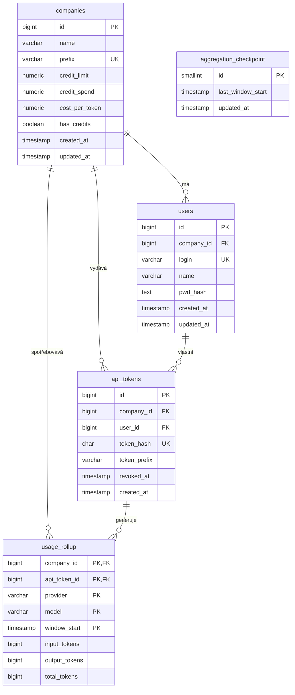
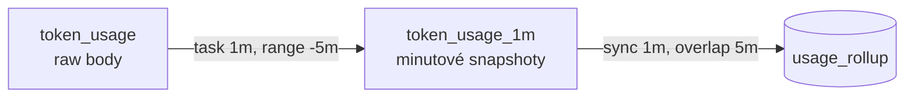

# Entity.md – datové entity

Tento dokument je **jediný zdroj pravdy pro datové schéma** Token Routeru. Popisuje entity
v PostgreSQL (SQL) a v InfluxDB (NoSQL) včetně mapování na Kotlin modely a kontraktu
mezi oběma úložišti.

## 0. Závaznost a vývoj schématu

| Úložiště | Typ | Závaznost | Změna schématu |
|---|---|---|---|
| PostgreSQL | relační, SQL | **autoritativní** | nová Flyway migrace (`V2__…`), nikdy úprava aplikované migrace |
| InfluxDB | time-series, NoSQL | **evoluční snapshot** | bez migrace; pouze aditivní změny, změna tag setu = nový measurement |

- PostgreSQL je zdroj pravdy pro identitu, limity, tokeny a read model.
- InfluxDB je write model (append-only event store). Nikdy se z něj nečte na kritické
  cestě requestu.
- Dokument popisuje **cílový stav**. Stávající `V1__create_schema.sql` zůstává
  aplikovaný; rozdíly řeší `V2` (viz 3.6).

  
## 3. PostgreSQL

### 3.1 `companies`

Společnost, její kreditní limit a odvozený stav pro rychlé rozhodnutí proxy.

```sql
CREATE TABLE companies (
    id             BIGSERIAL PRIMARY KEY,
    name           VARCHAR(255)  NOT NULL,
    prefix         VARCHAR(64)   NOT NULL UNIQUE,
    credit_limit   NUMERIC(18,6) NOT NULL DEFAULT 0,
    credit_spend   NUMERIC(18,6) NOT NULL DEFAULT 0,
    cost_per_token NUMERIC(18,8) NOT NULL DEFAULT 0,
    has_credits    BOOLEAN       NOT NULL DEFAULT TRUE,
    created_at     timestamp   NOT NULL DEFAULT now(),
    updated_at     timestamp   NOT NULL DEFAULT now(),
    CONSTRAINT companies_credit_limit_non_negative CHECK (credit_limit >= 0),
    CONSTRAINT companies_credit_spend_non_negative CHECK (credit_spend >= 0)
);
```

| Sloupec | Význam |
|---|---|
| `prefix` | prefix virtuálních tokenů (`acme-…`), unikátní |
| `credit_limit` | limit v USD |
| `credit_spend` | spotřeba v USD, **odvozená** z `usage_rollup` sync jobem |
| `cost_per_token` | cena za 1 token v USD, konfigurace společnosti |
| `has_credits` | `credit_spend < credit_limit`; **denormalizováno** pro rychlý přístup proxy |

Pravidla:

- `credit_spend` a `has_credits` se nikdy needitují ručně; přepočítává je `UsageSyncJob`
  (3.5). Navýšení limitu se dělá změnou `credit_limit`, přepočet stavu provede další běh.
- `has_credits = FALSE` znamená, že proxy má vracet `402` (lokální `SpendLedger` může
  zablokovat i dříve).


### 3.2 `users`

```sql
CREATE TABLE users (
    id         BIGSERIAL PRIMARY KEY,
    company_id BIGINT       NOT NULL REFERENCES companies (id),
    login      VARCHAR(255) NOT NULL UNIQUE,
    name       VARCHAR(255) NOT NULL,
    pwd_hash   TEXT         NOT NULL,
    created_at timestamp  NOT NULL DEFAULT now(),
    updated_at timestamp  NOT NULL DEFAULT now()
);

CREATE INDEX idx_users_company ON users (company_id);
```

| Sloupec | Význam |
|---|---|
| `login` | unikátní přihlašovací jméno |
| `pwd_hash` | bcrypt hash hesla |


### 3.3 `api_tokens`

Virtuální API token. Nahrazuje původní tabulku `api_keys`.

```sql
CREATE TABLE api_tokens (
    id           BIGSERIAL PRIMARY KEY,
    company_id   BIGINT      NOT NULL REFERENCES companies (id),
    user_id      BIGINT      NOT NULL REFERENCES users (id),
    token_hash   CHAR(64)    NOT NULL UNIQUE, -- SHA-256 hex
    token_prefix VARCHAR(16) NOT NULL,        -- pro maskovaný výpis
    revoked_at   timestamp NULL,            -- NULL = aktivní
    created_at   timestamp NOT NULL DEFAULT now()
);

CREATE INDEX idx_api_tokens_company ON api_tokens (company_id);
CREATE INDEX idx_api_tokens_user ON api_tokens (user_id);
```

| Sloupec | Význam |
|---|---|
| `token_hash` | SHA-256 z celého tokenu; vyhledávací klíč při autentizaci |
| `token_prefix` | prvních 16 znaků tokenu (`acme-****9c2e`) |
| `revoked_at` | `NULL` = aktivní; jinak čas revokace. Token se nikdy nemaže tvrdě |
| `user_id` | vlastník tokenu; nutné pro per-user statistiky a revokaci při deaktivaci uživatele |


### 3.4 `usage_rollup` – minutový read model

Idempotentní projekce minutových snapshotů z InfluxDB.

```sql
CREATE TABLE usage_rollup (
    company_id    BIGINT      NOT NULL REFERENCES companies (id),
    api_token_id  BIGINT      NOT NULL REFERENCES api_tokens (id),
    provider      VARCHAR(32) NOT NULL,
    model         VARCHAR(128) NOT NULL,
    window_start  timestamp NOT NULL,
    input_tokens  BIGINT      NOT NULL,
    output_tokens BIGINT      NOT NULL,
    total_tokens  BIGINT      NOT NULL,
    PRIMARY KEY (company_id, api_token_id, provider, model, window_start),
    CONSTRAINT usage_rollup_total_matches
        CHECK (total_tokens = input_tokens + output_tokens),
    CONSTRAINT usage_rollup_tokens_non_negative
        CHECK (input_tokens >= 0 AND output_tokens >= 0),
    CONSTRAINT usage_rollup_minute_aligned
        CHECK (date_trunc('minute', window_start) = window_start),
    CONSTRAINT usage_rollup_provider_valid
        CHECK (provider IN ('OPENAI', 'ANTHROPIC', 'DEEPSEEK'))
);

CREATE INDEX idx_usage_rollup_company_time
    ON usage_rollup (company_id, window_start);
CREATE INDEX idx_usage_rollup_token_time
    ON usage_rollup (api_token_id, window_start);
CREATE INDEX idx_usage_rollup_model_time
    ON usage_rollup (model, window_start);
```

| Sloupec | Význam |
|---|---|
| `window_start` | začátek minutového okna, UTC, zarovnáno na minutu |
| `total_tokens` | `input_tokens + output_tokens` |
| PK | zaručuje idempotentní upsert; opakovaný import nevytvoří duplicity |


### 3.5 `aggregation_checkpoint`

Jednořádkový stav sync jobu. Odděluje „kam jsem doimportoval“ od „co je už finální“.

```sql
CREATE TABLE aggregation_checkpoint (
    id                SMALLINT    PRIMARY KEY DEFAULT 1,
    last_window_start timestamp,             -- poslední okno, které job viděl
    updated_at        timestamp NOT NULL DEFAULT now(),
    CONSTRAINT aggregation_checkpoint_singleton CHECK (id = 1)
);

INSERT INTO aggregation_checkpoint (id) VALUES (1) ON CONFLICT DO NOTHING;
```

| Sloupec | Význam |
|---|---|
| `last_window_start` | maximum `window_start` z posledního úspěšného importu (může být otevřená minuta) |
| `updated_at` | čas posledního úspěšného běhu (i když se nic neuzavřelo) |

## 4. InfluxDB (NoSQL, evoluční)

Konfigurace: org `tokenrouter`, buckety `usage` a `usage_aggregation`.

### 4.1 Buckety

| Bucket | Measurement | Účel | Retence |
|---|---|---|---|
| `usage` | `token_usage` | raw eventy, append-only | 30 dní  |
| `usage_aggregation` | `token_usage_1m` | minutové snapshoty pro sync | 90 dní |


### 4.2 `token_usage` (raw)

| Prvek | Název | Význam |
|---|---|---|
| tag | `company_id` | společnost |
| tag | `api_token_id` | token, ze kterého request přišel (stabilní `api_tokens.id`) |
| tag | `provider` | `OPENAI`, `ANTHROPIC`, `DEEPSEEK` |
| tag | `model` | kanonický název modelu |
| field | `input_tokens` | input/prompt tokeny (integer) |
| field | `output_tokens` | output/completion tokeny (integer) |
| field | `total_tokens` | součet (integer) |
| time | `_time` | čas vzniku usage, ms |


Line protocol:

```text
token_usage,company_id=1,api_token_id=12,provider=OPENAI,model=gpt-4o-mini input_tokens=500i,output_tokens=300i,total_tokens=800i, 1730000000000000000
```

### 4.3 `token_usage_1m` (snapshot)

Stejné tagy jako raw, stejné integer fieldy (`input_tokens`, `output_tokens`,
`total_tokens`), `_time` = **začátek** minutového okna.

- Body jsou idempotentní: stejný tag set + stejný `_time` se přepíše.

Flux task:

```flux
option task = {
    name: "aggregate_usage_1m",
    every: 1m,
    offset: 10s,
}

from(bucket: "usage")
    |> range(start: -5m)
    |> filter(fn: (r) => r._measurement == "token_usage")
    |> filter(fn: (r) =>
        r._field == "input_tokens" or
        r._field == "output_tokens" or
        r._field == "total_tokens"
    )
    |> aggregateWindow(
        every: 1m,
        fn: sum,
        createEmpty: false,
        timeSrc: "_start",
    )
    |> to(
        bucket: "usage_aggregation",
        org: "tokenrouter",
        measurement: "token_usage_1m",
    )
```

Vlastnosti:

- `range(start: -5m)` = překryv, aby se zachytila pozdní data a výpadek tasku.
- `timeSrc: "_start"` nastaví `_time` na začátek okna (ne na konec).
- `createEmpty: false` negeneruje prázdné buckety.
- Opakovaný běh za stejné okno přepíše stejný bod → idempotence.
- Bucket `usage_aggregation` musí existovat a token musí mít write právo.

### 4.4 Zápis z proxy

```kotlin
suspend fun writeUsage(event: UsageEvent) {
    val point = Point
        .measurement("token_usage")
        .addTag("company_id", event.companyId.toString())
        .addTag("api_token_id", event.apiTokenId.toString())
        .addTag("provider", event.provider)
        .addTag("model", event.model)
        .addField("input_tokens", event.inputTokens)
        .addField("output_tokens", event.outputTokens)
        .addField("total_tokens", event.totalTokens)
        .addField("estimated", event.estimated)
        .time(Instant.ofEpochMilli(event.timestampMs), WritePrecision.MS)

    influx.writeApiBlocking.writePoint(point)
}
```

Zápis je asynchroní při chybě se opakuje nebo následně selže a zaloguje se.


## 6. Kontrakt mezi úložišti a sync job


## 8. ERD (PostgreSQL)



InfluxDB konceptuálně:



## 9. Užitečné dotazy

Spotřeba společnosti:

```sql
SELECT SUM(total_tokens) AS total_tokens
FROM usage_rollup
WHERE company_id = :companyId;
```

Časová řada pro graf:

```sql
SELECT window_start, SUM(total_tokens) AS total_tokens
FROM usage_rollup
WHERE company_id = :companyId
  AND window_start >= :from
  AND window_start < :to
GROUP BY window_start
ORDER BY window_start;
```

Rozpad podle tokenu:

```sql
SELECT api_token_id, SUM(total_tokens) AS total_tokens
FROM usage_rollup
WHERE company_id = :companyId
  AND window_start >= :from
GROUP BY api_token_id
ORDER BY total_tokens DESC;
```

Stav limitu:

```sql
SELECT id,
       credit_limit,
       credit_spend,
       credit_limit - credit_spend AS remaining,
       has_credits
FROM companies
WHERE id = :companyId;
```

