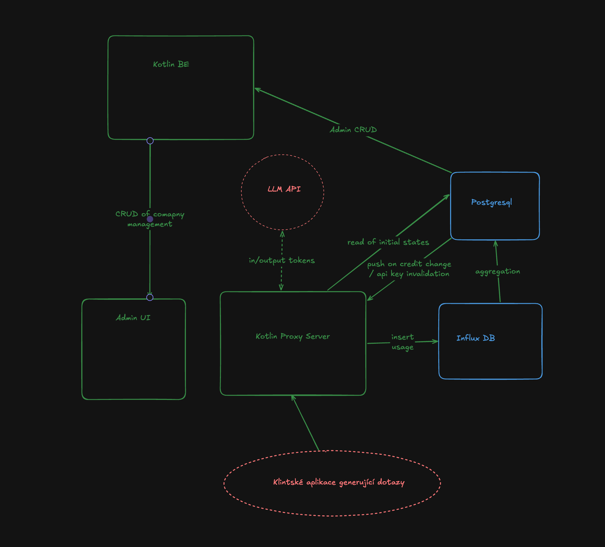

# Návrh - TokenRouter

Token Router je middle proxy mezi klientskými aplikacemi a LLM providery. Řeší
spotřebu tokenů, blokování po vyčerpání limitu, CRUD uživatelů a API
tokenů a read-only dashboard se statistikami.

Rozsah:

- proxy pro OpenAI a Anthropic protokol,
- billable inference routes a non-billable routes (`/v1/models`, count tokens),
- sledování spotřeby tokenů a limitu po minutách,
- blokování requestů po vyčerpání limitu,
- CRUD uživatelů a virtuálních API tokenů,
- dashboard read-only nad agregovanými daty,
- CQRS: InfluxDB jako write model, PostgreSQL jako read model a control plane.

# Architecture



## Topologie

<!-- mmd:navrh-0 -->


## Volba databází

PostgreSQL:

- ACID pro limity, uživatele a tokeny,
- foreign keys, unique constraints, indexy,
- `LISTEN/NOTIFY` pro pub/sub mezi DB a proxy,
- read model pro dashboard.

InfluxDB:

- vysoký počet timestampovaných append-only zápisů,
- tagy indexované, fieldy sčitatelné,
- retention a Flux agregace,

## Tok dat

```text
Proxy request
  -> InfluxUsageWriter.write(event)
  -> InfluxDB usage.token_usage
  -> AggregationTask (1 min)
  -> InfluxDB usage_aggregation.token_usage_1m
  -> UsageSyncJob (1 min)
  -> PostgreSQL usage_rollup + companies
  -> Dashboard / Admin UI
```

InfluxDB je write model a nikdy se z něj nečte na kritické cestě requestu.
Dashboard čte pouze PostgreSQL. Agregační job běží v Kotlin serveru, protože
zapisuje do PostgreSQL. InfluxDB tasky dělají pouze agregaci v rámci InfluxDB.

# CQRS

## Hranice systémů

| Část | Úložiště | Role |
|---|---|---|
| `usage.token_usage` | InfluxDB | zdroj pravdy o usage, append-only eventy |
| `usage_aggregation.token_usage_1m` | InfluxDB | minutové snapshoty |
| `usage_rollup` | PostgreSQL | read model pro dashboard |
| `companies` | PostgreSQL | control plane + denormalizovaný credit stav |
| `users`, `api_tokens` | PostgreSQL | control plane |
| `aggregation_checkpoint` | PostgreSQL | stav sync jobu |

Zdroje pravdy:

- **Usage** = InfluxDB. Při rozporu s `usage_rollup` je správně InfluxDB a rollup se
  doplní backfillem.
- **Identita, limity, tokeny** = PostgreSQL. InfluxDB obsahuje jen jejich ID.

## Command side

### Billable request

1. `ApiTokenResolver` ověří token.
2. `RequestEstimator` odhadne input tokeny.
3. `CreditGuard.authorize()` zkontroluje `SpendLedger` a rezervuje limit.
4. `UpstreamClient` forwarduje request na providera.
5. `UsageExtractor` vytvoří `UsageEvent`.
6. `SpendLedger.settle()` uvolní rezervaci a přičte skutečnou spotřebu.
7. `InfluxUsageWriter.write(event)` zapíše bod do `usage.token_usage`.

Vlastnosti:

- Zápis do InfluxDB je synchronní; mezi proxy a InfluxDB není buffer ani queue.
- Event je at-least-once; idempotence je řešena až v read modelu (PK rollupu).
- Selhání zápisu se loguje a zvýší metriku; request už je dokončený.
- `user_id` se do InfluxDB neposílá; dohledá se přes `api_tokens.user_id`.

### Control plane commandy

CRUD uživatelů a tokenů zapisuje přímo do PostgreSQL (transakčně) a po commitu
publikuje `api_token_events`:

- `ApiTokenEventSubscriber` invaliduje `ApiTokenCache`.
- Revokace tokenu nastaví `revoked_at = now()`.
- Tokeny se nikdy nemažou tvrdě; `api_tokens.id` zůstává stabilní pro InfluxDB.

## Aggregace ve write modelu

Proxy zapisuje raw eventy; InfluxDB task z nich každou minutu dělá snapshot:

```flux
option task = {
    name: "aggregate_usage_1m",
    every: 1m,
    offset: 10s,
}

from(bucket: "usage")
    |> range(start: -5m)
    |> filter(fn: (r) => r._measurement == "token_usage")
    |> filter(fn: (r) =>
        r._field == "input_tokens" or
        r._field == "output_tokens" or
        r._field == "total_tokens"
    )
    |> aggregateWindow(
        every: 1m,
        fn: sum,
        createEmpty: false,
        timeSrc: "_start",
    )
    |> to(
        bucket: "usage_aggregation",
        org: "tokenrouter",
        measurement: "token_usage_1m",
    )
```

- `range(start: -5m)` je překryv pro pozdní data a krátký výpadek tasku.
- `timeSrc: "_start"` nastaví `_time` na začátek okna.
- Opakovaný běh přepíše stejný bod → idempotence.
- Task umí zapisovat jen do InfluxDB, ne do PostgreSQL.

## Read side

### `usage_rollup`

Minutový read model. Upsert podle PK
`(company_id, api_token_id, provider, model, window_start)` zaručuje, že opakovaný
import nevytvoří duplicity.

```sql
INSERT INTO usage_rollup
    (company_id, api_token_id, provider, model, window_start,
     input_tokens, output_tokens, total_tokens)
VALUES (?, ?, ?, ?, ?, ?, ?, ?)
ON CONFLICT (company_id, api_token_id, provider, model, window_start)
DO UPDATE SET
    input_tokens  = EXCLUDED.input_tokens,
    output_tokens = EXCLUDED.output_tokens,
    total_tokens  = EXCLUDED.total_tokens;
```

### Checkpoint

`aggregation_checkpoint` drží `last_window_start` – poslední importované okno,
aby se po výpadku vykryly failnuté joby. Job vždy čte s překryvem `OVERLAP`.

### `UsageSyncJob`

Běží každou minutu, v jedné instanci (advisory lock), a je idempotentní.

```kotlin
class UsageSyncJob(
    private val influx: InfluxUsageReader,
    private val rollup: UsageRollupRepository,
    private val checkpoint: UsageCheckpointRepository,
    private val credits: CompanyCreditRepository,
) {
    suspend fun runOnce() {
        if (!checkpoint.tryAdvisoryLock()) return
        try {
            val state = checkpoint.load()
            val from = state.lastWindowStart?.minus(OVERLAP)
                ?: Instant.now().minus(OVERLAP).minus(WINDOW)

            val rows = influx.readSnapshots(from)       // token_usage_1m
            if (rows.isEmpty()) {
                checkpoint.touch()                      // updated_at = now()
                return
            }

            transaction {
                rollup.upsertAll(rows)                  // idempotentní
                val companyIds = rows.map { it.companyId }.distinct()
                credits.recompute(companyIds)           // credit_spend + has_credits
                checkpoint.save(
                    lastWindowStart = rows.maxOf { it.windowStart },
                )
            }
            credits.publishEvents(companyIds)           // pg_notify credit_events
        } finally {
            checkpoint.releaseAdvisoryLock()
        }
    }
}
```

### Přepočet kreditu

Po upsertu se pro dotčené společnosti přepočítá spotřeba absolutně:

```sql
UPDATE companies c
SET credit_spend = s.total_tokens * c.cost_per_token,
    has_credits  = (s.total_tokens * c.cost_per_token) < c.credit_limit,
    updated_at   = now()
FROM (
    SELECT company_id, SUM(total_tokens) AS total_tokens
    FROM usage_rollup
    WHERE company_id = ANY (:companyIds)
    GROUP BY company_id
) s
WHERE c.id = s.company_id;
```

- Absolutní přepočet řeší pozdní data i změnu `cost_per_token`.
- `has_credits` se mění oběma směry (vyčerpání i navýšení limitu).
- Po změně se publikuje `credit_events` do proxy.

### Query side

Dashboard čte pouze PostgreSQL:

| Endpoint | Čte |
|---|---|
| `GET /api/companies` | `companies` |
| `GET /api/companies/{id}` | `companies`, `users`, `api_tokens` (maskovaně) |
| `GET /api/usage?companyId=&from=&to=&groupBy=` | `usage_rollup` |
| `GET /api/limit-status?companyId=` | `companies` |

Query side je read-only a neprovádí žádné zápisy.

## Konzistence a čerstvost

| Data | Zpoždění |
|---|---|
| `usage.token_usage` | 0 (synchronní zápis) |
| `token_usage_1m` | do 1 min + `FLUX_OFFSET` |
| `usage_rollup` | do `SYNC_INTERVAL + LATE_GRACE` (typicky 1–2 min) |
| `companies.has_credits` | stejné jako `usage_rollup` |
| Proxy rozhodnutí o 402 | okamžité díky `SpendLedger` |

Model je eventually consistent s garantovanou idempotencí: snapshoty i rollup
přepisují stejná okna, takže libovolný počet opakování dá stejný stav. Read model
lze kdykoli přestavět backfillem z InfluxDB.

## Credit enforcement

Dvě vrstvy:

1. **Lokální `SpendLedger`** v proxy – brání
   nekontrolovanému overspendu mezi synchronizacemi.
2. **PostgreSQL `has_credits`** – autoritativní stav pro dashboard a korekci,
   aktualizovaný každou minutu.

Proxy používá `has_credits` z cache napájené `credit_events`. `NOTIFY` není
durable → při startu a reconnectu se dělá plný resync.

## Failure modes

| Situace | Chování | Dopad |
|---|---|---|
| InfluxDB write selže 3x | log + metrika, request pokračuje | usage event se ztratí |
| Flux task selže | další běh pokryje `-5m` | snapshot se zpozdí |
| Sync job selže | checkpoint se neposune, další běh opakuje | beze ztráty, jen zpoždění |
| `NOTIFY` se ztratí | resync při startu/reconnectu | dočasně starý credit stav |
| Pozdní event < `OVERLAP` | další běh okno přepíše | správná data |
| Pozdní event > `OVERLAP` | mimo automatickou opravu | manuální backfill |
| InfluxDB unavailable při dotazu | dashboard čte PostgreSQL | bez dopadu na čtení |

# Tables

PostgreSQL je autoritativní schéma verzované Flyway migracemi; InfluxDB je evoluční
snapshot bez migrací.

## PostgreSQL

### `companies`

```sql
CREATE TABLE companies (
    id             BIGSERIAL PRIMARY KEY,
    name           VARCHAR(255)  NOT NULL,
    prefix         VARCHAR(64)   NOT NULL UNIQUE,
    credit_limit   NUMERIC(18,6) NOT NULL DEFAULT 0,
    credit_spend   NUMERIC(18,6) NOT NULL DEFAULT 0,
    cost_per_token NUMERIC(18,8) NOT NULL DEFAULT 0,
    has_credits    BOOLEAN       NOT NULL DEFAULT TRUE,
    created_at     timestamp     NOT NULL DEFAULT now(),
    updated_at     timestamp     NOT NULL DEFAULT now(),
    CONSTRAINT companies_credit_limit_non_negative CHECK (credit_limit >= 0),
    CONSTRAINT companies_credit_spend_non_negative CHECK (credit_spend >= 0)
);
```

| Sloupec | Význam |
|---|---|
| `prefix` | prefix virtuálních tokenů (`acme-…`), unikátní |
| `credit_limit` | limit v USD |
| `credit_spend` | spotřeba v USD, odvozená z `usage_rollup` sync jobem |
| `cost_per_token` | cena za 1 token v USD |
| `has_credits` | `credit_spend < credit_limit`; denormalizováno pro proxy |

`credit_spend` a `has_credits` se needitují ručně; přepočítává je `UsageSyncJob`.
`has_credits = FALSE` znamená `402` (lokální `SpendLedger` může zablokovat i dříve).

### `users`

```sql
CREATE TABLE users (
    id         BIGSERIAL PRIMARY KEY,
    company_id BIGINT       NOT NULL REFERENCES companies (id),
    login      VARCHAR(255) NOT NULL UNIQUE,
    name       VARCHAR(255) NOT NULL,
    pwd_hash   TEXT         NOT NULL,
    created_at timestamp    NOT NULL DEFAULT now(),
    updated_at timestamp    NOT NULL DEFAULT now()
);

CREATE INDEX idx_users_company ON users (company_id);
```

| Sloupec | Význam |
|---|---|
| `login` | unikátní přihlašovací jméno |
| `pwd_hash` | bcrypt hash hesla |

### `api_tokens`

```sql
CREATE TABLE api_tokens (
    id           BIGSERIAL PRIMARY KEY,
    company_id   BIGINT      NOT NULL REFERENCES companies (id),
    user_id      BIGINT      NOT NULL REFERENCES users (id),
    token_hash   CHAR(64)    NOT NULL UNIQUE, -- SHA-256 hex
    token_prefix VARCHAR(16) NOT NULL,        -- pro maskovaný výpis
    revoked_at   timestamp   NULL,            -- NULL = aktivní
    created_at   timestamp   NOT NULL DEFAULT now()
);

CREATE INDEX idx_api_tokens_company ON api_tokens (company_id);
CREATE INDEX idx_api_tokens_user ON api_tokens (user_id);
```

| Sloupec | Význam |
|---|---|
| `token_hash` | SHA-256 z celého tokenu; vyhledávací klíč při autentizaci |
| `token_prefix` | prvních 16 znaků tokenu (`acme-****9c2e`) |
| `revoked_at` | `NULL` = aktivní |
| `user_id` | vlastník tokenu; per-user statistiky a revokace |

Plaintext token se vrací pouze jednou při vytvoření. Token se nikdy nemaže tvrdě,
protože na `api_tokens.id` odkazuje `usage_rollup`.

### `usage_rollup`

```sql
CREATE TABLE usage_rollup (
    company_id    BIGINT      NOT NULL REFERENCES companies (id),
    api_token_id  BIGINT      NOT NULL REFERENCES api_tokens (id),
    provider      VARCHAR(32) NOT NULL,
    model         VARCHAR(128) NOT NULL,
    window_start  timestamp   NOT NULL,
    input_tokens  BIGINT      NOT NULL,
    output_tokens BIGINT      NOT NULL,
    total_tokens  BIGINT      NOT NULL,
    PRIMARY KEY (company_id, api_token_id, provider, model, window_start),
    CONSTRAINT usage_rollup_total_matches
        CHECK (total_tokens = input_tokens + output_tokens),
    CONSTRAINT usage_rollup_tokens_non_negative
        CHECK (input_tokens >= 0 AND output_tokens >= 0),
    CONSTRAINT usage_rollup_minute_aligned
        CHECK (date_trunc('minute', window_start) = window_start),
    CONSTRAINT usage_rollup_provider_valid
        CHECK (provider IN ('OPENAI', 'ANTHROPIC', 'DEEPSEEK'))
);

CREATE INDEX idx_usage_rollup_company_time
    ON usage_rollup (company_id, window_start);
CREATE INDEX idx_usage_rollup_token_time
    ON usage_rollup (api_token_id, window_start);
CREATE INDEX idx_usage_rollup_model_time
    ON usage_rollup (model, window_start);
```

| Sloupec | Význam |
|---|---|
| `window_start` | začátek minutového okna, zarovnáno na minutu |
| `total_tokens` | `input_tokens + output_tokens` |
| PK | zaručuje idempotentní upsert |

### `aggregation_checkpoint`

```sql
CREATE TABLE aggregation_checkpoint (
    id                SMALLINT  PRIMARY KEY DEFAULT 1,
    last_window_start timestamp,             -- poslední okno, které job viděl
    updated_at        timestamp NOT NULL DEFAULT now(),
    CONSTRAINT aggregation_checkpoint_singleton CHECK (id = 1)
);

INSERT INTO aggregation_checkpoint (id) VALUES (1) ON CONFLICT DO NOTHING;
```

| Sloupec | Význam |
|---|---|
| `last_window_start` | maximum `window_start` z posledního úspěšného importu |
| `updated_at` | čas posledního úspěšného běhu |

### Migrace

Pomocí Flyway se budou řešit migrace.

## InfluxDB

Konfigurace: org `tokenrouter`, buckety `usage` a `usage_aggregation`.

| Bucket | Measurement | Účel | Retence |
|---|---|---|---|
| `usage` | `token_usage` | raw eventy, append-only | 30 dní |
| `usage_aggregation` | `token_usage_1m` | minutové snapshoty pro sync | 90 dní |

### `token_usage` (raw)

| Prvek | Název | Význam |
|---|---|---|
| tag | `company_id` | společnost |
| tag | `api_token_id` | token, ze kterého request přišel |
| tag | `provider` | `OPENAI`, `ANTHROPIC`, `DEEPSEEK` |
| tag | `model` | kanonický název modelu |
| field | `input_tokens` | input/prompt tokeny (integer) |
| field | `output_tokens` | output/completion tokeny (integer) |
| field | `total_tokens` | součet (integer) |
| time | `_time` | čas vzniku usage, ms |

`user_id` není tag; dohledá se přes `api_tokens.user_id`.

Line protocol:

```text
token_usage,company_id=1,api_token_id=12,provider=OPENAI,model=gpt-4o-mini input_tokens=500i,output_tokens=300i,total_tokens=800i 1730000000000000000
```

Zápis z proxy:

```kotlin
suspend fun writeUsage(event: UsageEvent) {
    val point = Point
        .measurement("token_usage")
        .addTag("company_id", event.companyId.toString())
        .addTag("api_token_id", event.apiTokenId.toString())
        .addTag("provider", event.provider)
        .addTag("model", event.model)
        .addField("input_tokens", event.inputTokens)
        .addField("output_tokens", event.outputTokens)
        .addField("total_tokens", event.totalTokens)
        .time(Instant.ofEpochMilli(event.timestampMs), WritePrecision.MS)

    influx.writeApiBlocking.writePoint(point)
}
```

### `token_usage_1m` (snapshot)

Stejné tagy a fieldy jako raw; `_time` = začátek minutového okna. Body jsou
idempotentní: stejný tag set + `_time` se přepíše.

Flux task je v sekci CQRS. `range(start: -5m)` zajišťuje překryv, `timeSrc: "_start"`
začátek okna a `createEmpty: false` negeneruje prázdné buckety.

### Pravidla změny NoSQL schématu

- Lze přidávat fieldy; čtenáři ignorují neznámé fieldy.
- Nelze měnit význam existujícího tagu ani typu fieldu.
- Změna tag setu = nový measurement + backfill.
- `api_tokens.id` se nikdy nerecykluje.
- Retence nesmí zkrátit okno potřebné pro `LATE_GRACE` a backfill.

## ERD

<!-- mmd:navrh-1 -->


InfluxDB konceptuálně:

<!-- mmd:navrh-2 -->


## Užitečné dotazy

Spotřeba společnosti:

```sql
SELECT SUM(total_tokens) AS total_tokens
FROM usage_rollup
WHERE company_id = :companyId;
```

Časová řada pro graf:

```sql
SELECT window_start, SUM(total_tokens) AS total_tokens
FROM usage_rollup
WHERE company_id = :companyId
  AND window_start >= :from
  AND window_start < :to
GROUP BY window_start
ORDER BY window_start;
```

Rozpad podle tokenu:

```sql
SELECT api_token_id, SUM(total_tokens) AS total_tokens
FROM usage_rollup
WHERE company_id = :companyId
  AND window_start >= :from
GROUP BY api_token_id
ORDER BY total_tokens DESC;
```

Stav limitu:

```sql
SELECT id,
       credit_limit,
       credit_spend,
       credit_limit - credit_spend AS remaining,
       has_credits
FROM companies
WHERE id = :companyId;
```

# Testování

Testování není běžné vývojové testování, ale **validace architektury a simulace
provozu**. Cílem je ověřit, že CQRS tok, agregace, limity a UI drží pod zátěží,
při souběhu a při výpadcích.

## Simulační harness

- **Fake client** generuje OpenAI/Anthropic requesty: 100–500 souběžných klientů,
  konfigurovatelný rate, deterministické chování.
- **Fake upstream** nahrazuje LLM a vrací pevné usage (např. `input=500`,
  `output=300`, `total=800`), takže očekávané součty jsou přesně známé.
- **Seed** vytvoří společnosti, uživatele a tokeny s definovaným limitem.
- **Admin UI** zobrazuje průběh: počet requestů, tokeny, spotřebu, `has_credits`,
  počet `402`, stav agregace. Vše, co simulace vyprodukuje, je viditelné v UI.

## Scénáře

| # | Scénář | Zátěž | Očekávaný výsledek |
|---|---|---|---|
| S1 | Baseline | 1 společnost, 10 uživatelů, 20 tokenů, 100 requestů | všech 100 viditelných v UI, `total = 80 000` tokenů |
| S2 | Souběh | 200 souběžných klientů, 2 min, ~1 req/s každý (≈24 000 requestů) | chybovost < 1 %, usage zachycen, rollup bez duplicit |
| S3 | Sustained load | 100 souběžných klientů, 30 min (≈180 000 requestů) | lag agregace ≤ 2 min, proxy stabilní, UI konzistentní |
| S4 | Limit a 402 | limit na přesně 1 000 requestů, poslat 1 200 při 100 souběžných | ~1 000× `200`, ~200× `402`, overspend ≤ jedno in-flight okno |
| S5 | Burst | 500 souběžných klientů, 10 s (≈5 000 requestů) | žádný pád, ztráta ≤ 1 %, InfluxDB write latency stabilní |
| S6 | Výpadek Flux tasku | 100 req/s, task zastaven na 3 min | po obnovení overlap dožene data, součty sedí |
| S7 | Crash sync jobu | 5× kill během transakce, 100 req/s | žádné duplicity, checkpoint se posune jen po commitu |
| S8 | Výpadek InfluxDB | 60 s nedostupná, 100 req/s | proxy běží dál, ztráta ≤ 6 000 eventů zalogována, UI ukáže rozdíl |
| S9 | Ztracený NOTIFY | změna limitu, restart proxy | resync po startu načte správný `has_credits` |

## Co se vyhodnocuje

| Metrika | Cíl |
|---|---|
| Úspěšné requesty vs. zapsané usage | 100 % pro úspěšné requesty (mimo simulované výpadky) |
| Rozdíl Influx vs. `usage_rollup` | 0 tokenů po dokončení agregace |
| Lag `usage_rollup` | ≤ 2 min |
| Přesnost `402` | žádný request nad limitem mimo in-flight okno |
| Dostupnost proxy | ≥ 99 % během všech scénářů |
| Viditelnost v Admin UI | všechny scénáře mají odpovídající data v UI |
