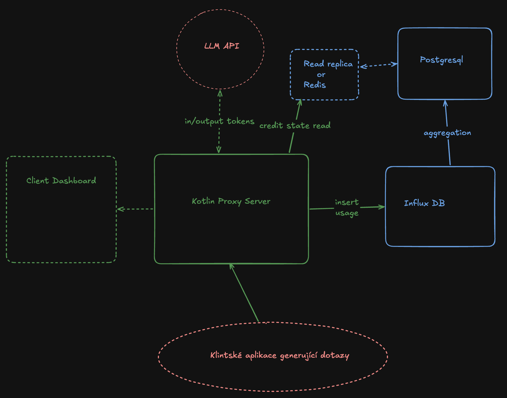

# Token Router

Middle proxy between clients app and LLM deployment. User buys AI API usage in our platform. Usage can de defined either as # req or # in/out-put tokens. 

### 3 functionalities:
- token spend tracking
- blocking incoming request once out of bounds
- buying more limit (for this demo manual setting)

### 2,5 issues:
- Heavy writes -> inserting usage
- Heavy reads -> checking if token owner has credit
    - Needs ACIDity -> money involved (not in this demo of course)

### Implementation
Kotlin server app which will route (fake) llm api calls to their destined url and monitor / log the usage of these endpoints. Also once the tokens are in the bounds will return `HTTP 402 Payment Required`. Account management will either be handled via thin web client. Web client will also show some interesting statistics about the usage.

Kotlin server writes log -> InfluxDB -> 5-10 minutes -> job aggregates data -> PostgreSQL -> data is cached to Redis or read replicas of PostgreSQL are created.

In the future can be used as a virtual keys which can be signed so the llm api keys are used in safe manner, therefore create more traffic from more places than just personal machines.

### Business proposition:
- Reselling tokens can be quite profitable
- With virtual keys we can allow client side llm APIs
- Enterprises need one place to monitor many usages

